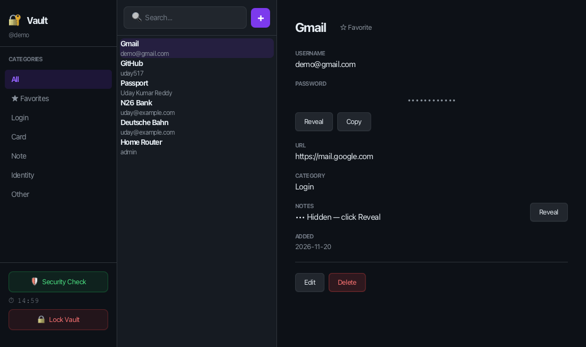
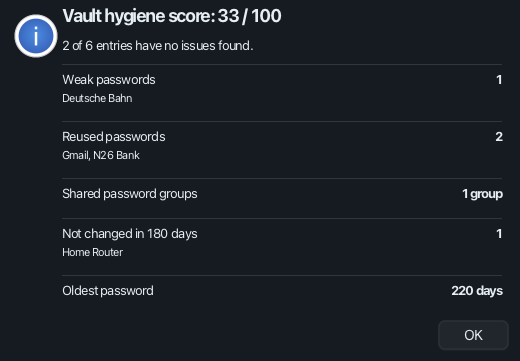
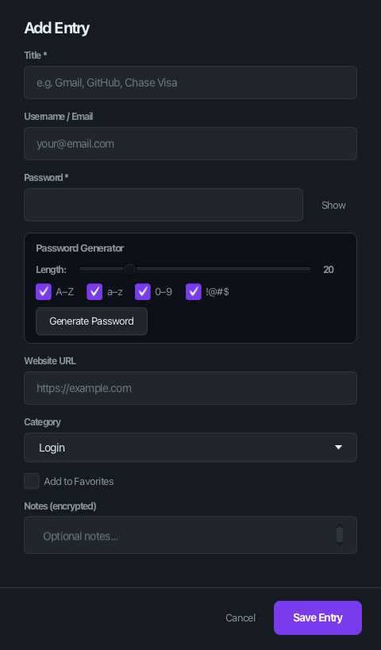

# Vault — a local-first password manager


Vault is a desktop password manager written in Java 21 and JavaFX. It stores all
data locally, encrypts every secret with AES-256-GCM, and keeps the vault key in
memory only. There is no account, no telemetry and no network access.

The project is deliberately small enough to audit: about 2,500 lines of
production Java, a threat model, and a test suite that includes property-based
tests for the cryptographic round-trip and the password generator.



| Password health check | Add-entry dialog |
| --- | --- |
|  |  |

The screenshots use a disposable demo vault created by a development harness;
no real credentials are involved.

## Why this project exists

Most student "password manager" projects stop at *"it encrypts the password
column"*. Vault is meant to demonstrate the parts that matter in a high-integrity
system:

- a written threat model with explicit residual risks,
- fail-closed handling of corrupt credentials and tampered ciphertext,
- deterministic, unit-tested lockout and session state machines,
- property-based tests over arbitrary inputs,
- reproducible builds and CI on Linux, macOS and Windows,
- honest documentation of what the design does **not** protect against.

## Features

| Area | What Vault does |
| --- | --- |
| Encryption | AES-256-GCM, fresh 12-byte IV per field, 128-bit authentication tag |
| Key derivation | PBKDF2-HMAC-SHA512, 600,000 iterations, 32-byte random salt |
| Domain separation | Vault key derived separately from the stored auth hash |
| Session | 15-minute idle lock, live countdown, key zeroed on lock |
| Login hardening | 5 attempts → 30-minute lockout; timing-equalised unknown-user path |
| Storage | SQLite WAL, `synchronous=FULL`, `secure_delete`, parameterised SQL |
| File permissions | Data directory `0700`, database/WAL/SHM `0600` on POSIX |
| Generator | `SecureRandom`, configurable classes, every selected class guaranteed |
| Notes | Encrypted separately, revealed on demand, auto-hidden after 30 s |
| Clipboard | Auto-cleared after 60 s, but only if it still contains Vault's secret |
| Security check | In-memory audit for weak, reused and 180-day-old passwords |
| UI | JavaFX, search, categories, favourites, keyboard-friendly dialogs |

## Security model in one page

```
master password
      │
      ├── PBKDF2-SHA512 (600k, salt) ──► auth hash ──► users.password_hash
      │
      └── PBKDF2-SHA512 (100k, salt || "vault-encryption-key-v1")
                    │
                    ▼
              32-byte vault key  (RAM only)
                    │
      ┌─────────────┴─────────────┐
      ▼                           ▼
 AES-256-GCM(password)      AES-256-GCM(notes)
 random 12-byte IV          random 12-byte IV
      │                           │
      └─────────► vault_entries (SQLite)
```

- **Fail closed.** A malformed stored hash, a short IV or a failed GCM tag is
  treated as an error; it never falls back to plaintext.
- **No key on disk.** Only the salt and the authentication hash are persisted.
- **Checks before plaintext.** GCM verifies the authentication tag before any
  decrypted bytes are returned.
- **Bounded secrets.** The vault key is copied per operation and zeroed in a
  `finally` block. Password `char[]` buffers are cleared after use.
- **Local only.** No HTTP client, no sync, no crash reporter, no analytics.

Full threat model: [`docs/THREAT_MODEL.md`](docs/THREAT_MODEL.md).

## Architecture

```
controllers/   Login, Register, Vault, Add/Edit — thin JavaFX layer
services/      AuthService, CryptoService, DatabaseService,
               SessionService, SecurityAuditService — no JavaFX imports
models/        Immutable records: User, VaultEntry, EncryptedData, ...
utils/         AppPaths — OS-specific data locations
```

The controllers never touch SQL or ciphertext directly. Authentication policy
(lockout, attempt counting, password policy, duplicate handling) lives in
`AuthService`, which is tested without starting JavaFX.

## Build and run

Requirements: JDK 21+ and a desktop session for the GUI. Maven is wrapped, so
nothing else is needed.

```bash
./mvnw clean verify          # compile + 39 tests + coverage report
./mvnw javafx:run            # run from source
./mvnw package               # build target/app/vault.jar
```

The Maven profile is selected automatically by operating system and CPU
architecture (`linux`, `win`, `mac`, `mac-aarch64`). If you cross-build, pass the
profile explicitly:

```bash
./mvnw package -P mac-aarch64
```

Coverage is written to `target/site/jacoco/index.html`.

### Package installers

Release builds use `jpackage` (see `.github/workflows/release.yml`) to produce
DMG, MSI, DEB and tar.gz artifacts. Tags matching `v*.*.*` trigger the release
workflow.

## Data location

| OS | Path |
| --- | --- |
| macOS | `~/Library/Application Support/VaultPasswordManager/vault.db` |
| Linux | `$XDG_DATA_HOME/VaultPasswordManager/vault.db` or `~/.local/share/VaultPasswordManager/vault.db` |
| Windows | `%APPDATA%\VaultPasswordManager\vault.db` |

Set `-Dvault.data.dir=/some/directory` to use a different location (useful for a
portable vault on a USB stick, or for tests).

## Tests

```bash
./mvnw test
```

39 tests cover:

- AES-GCM round-trips for arbitrary Unicode, unique IVs, tamper detection,
  wrong keys and malformed ciphertext;
- PBKDF2 salt uniqueness, verification, domain separation and malformed records;
- generator invariants over randomised lengths/class combinations (jqwik);
- database CRUD, per-user isolation, lockout persistence and POSIX permissions;
- session key copying/zeroing, idle timeout, refresh and manual lock;
- authentication lockout, expired-lockout reset, duplicate users, weak passwords;
- weak/reused/stale audit rules and the 180-day boundary.

There is no UI automation suite yet; the JavaFX layer is exercised manually and
through the service-level tests it delegates to.

## What changed in 1.1.0

- Fixed the vault never showing the signed-in username.
- Fixed the idle countdown drifting from the real session deadline.
- Fixed hidden labels reserving space (clipped logo/buttons on small screens).
- Fixed lockout never resetting after expiry.
- Fixed notes being visible only in the edit dialog; they now have a reveal
  action with auto-hide.
- Fixed clipboard clearing unrelated clipboard contents.
- Added a timing-equalised path for unknown usernames.
- Added a security check for weak, reused and stale passwords.
- Added `AuthService` and 39 automated tests, including property-based tests.
- Added Maven Wrapper, JaCoCo coverage and this threat model.
- Hardened SQLite settings and file permissions; serialised DB access.

## Known limitations

- **No independent audit.** The design follows well-known primitives, but this is
  a portfolio project, not an audited product.
- **JVM memory is not a secure enclave.** Zeroing arrays reduces exposure but
  cannot remove copies made by the JVM, the OS clipboard or a debugger.
- **A compromised user account wins.** Malware running as the same user can read
  memory, install a keylogger or modify the database. Vault protects data at
  rest, not a running host.
- **Metadata is plaintext.** Titles, usernames, URLs and categories are stored in
  clear so the list can be searched without decrypting everything.
- **No sync, import, export, password change or 2FA yet.** These are deliberate
  scope limits; see the roadmap below.
- **Rollback is not detected.** An attacker who can write to the database can
  restore an older copy. GCM prevents forgery, not replay.

## Roadmap

- Encrypted backup export/import with an explicit format version.
- Change-master-password flow that re-encrypts entries atomically.
- TOTP storage and generation.
- Argon2id KDF behind a versioned KDF field.
- TestFX smoke tests for the JavaFX flows.
- Reproducible-build attestations and signed release artifacts.

## License

Personal portfolio project. No license is granted for redistribution.
